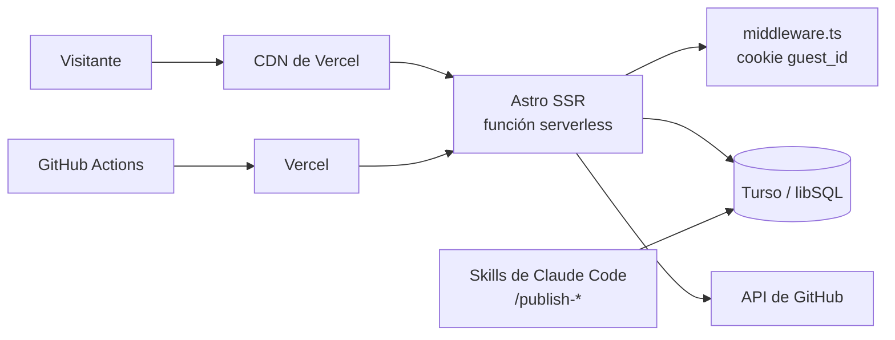
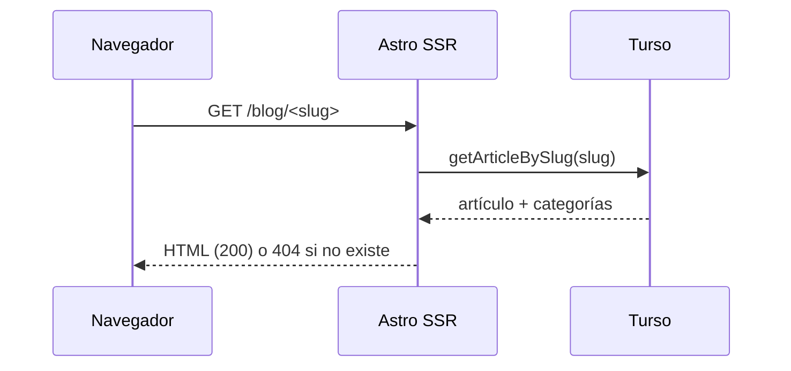

# TECH-DESIGN — Diseño técnico

- **Estado:** Vigente
- **Última revisión:** 2026-11-08
- **Documento anterior:** [DESIGN.md](DESIGN.md) · **Siguiente documento del pipeline:** [adr/README.md](adr/README.md)

> Responde a todos los RF y RNF del [PRD](PRD.md) (ver [§10](#10-trazabilidad-rfrnf--componente)). Describe el
> sistema que corre hoy en producción; el stack anterior (Strapi + AWS S3/CloudFront) está en
> [`archive/`](archive/) y ya no existe.

## 1. Contexto

Sitio personal en https://miguel-anay.nom.pe: blog, CV, cursos, exámenes de práctica y documentación de
repos. Lo mantiene una sola persona; el contenido se carga con skills de Claude Code directo en la base, sin
panel de administración ni build ([PRD §4](PRD.md)).

Stack verificado en `package.json`, `astro.config.mjs` y `vercel.json`:

| Capa | Tecnología |
|---|---|
| Framework | Astro 5.14 con `output: 'server'` (SSR) y `@astrojs/vercel` |
| UI | Astro, React 19 (islas), Tailwind 4, tokens CSS en `src/styles/global.css` |
| Animación y 3D | GSAP y three.js (solo portada) |
| Datos | Turso (libSQL) con Drizzle ORM |
| Hosting | Vercel (CDN con headers `Cache-Control`) |
| Pruebas | Vitest (unitarias), Playwright (E2E en `tests/e2e`) |
| Gestor | pnpm |
| CI | GitHub Actions (`.github/workflows/ci.yml`) |

## 2. Arquitectura



- Todas las páginas se renderizan en el servidor por request. No hay `getStaticPaths` ni contenido en el repo:
  el blog, el CV, los cursos y los exámenes salen de Turso.
- Excepción: el RSS se arma desde una colección de contenido que se carga en el build (ver nota de RF2 en §10).
- El contenido entra a la base por fuera del sitio (skills `/publish-articulo`, `/publish-cv`,
  `/publish-pregunta`, y `scripts/ingest-*.mjs`), por eso publicar no requiere desplegar (O2).
- Las migraciones de esquema viven en `src/lib/migrations/*.sql` y las aplica `scripts/migrate.mjs`
  ([DEPLOY.md](DEPLOY.md)).

## 3. Componentes por feature

Se aplica la Scope Rule: el código de una sola feature vive en `src/features/<feature>/`; lo que usan dos o más
va a `src/components/` o `src/lib/`.

| Feature | Rutas (`src/pages`) | Código propio | Acceso a datos |
|---|---|---|---|
| **blog** | `blog/`, `blog/[...slug]`, `blog/page/[page]`, `blog/category/[slug]`, `blog/categories`, `rss.xml.js`, `sitemap.xml.js` | `features/blog/components` (`DiagramBlock`, `FormattedDate`) | `getArticles`, `getArticleBySlug`, `getCategories` en `lib/api.ts` |
| **cv** | `cv.astro`, `about.astro` | secciones dentro de la página | `getCv` en `lib/api.ts` (tablas `cv_*`) |
| **courses** | `courses/`, `courses/[slug]`, `courses/[slug]/sections` | `features/courses/components`, `lib/sessions.ts` | `getCourses`, `getCourseBySlug` |
| **exams** | `exams/`, `exams/[slug]`, `exams/[slug]/attempt/[attemptId]` (+ `results`), `api/exams/attempts/**` | `features/exams/lib` (`timer`, `scoring`, `attempt-controller`), componentes de intento | `lib/exam-api.ts` |
| **docs** | `docs/`, `docs/[repo]/[...page]`, `docs/search.json.ts` | `features/docs/lib/github-docs.ts`, `repos.ts` (lista `DOC_REPOS`), `DocsShell` | API de GitHub (sin base de datos) |
| **home** | `index.astro` | `features/home/three` (escena), `HeroCanvas` | `getSiteConfig` |

Transversales: `src/middleware.ts` (invitado anónimo), `src/lib/db.ts` (cliente Drizzle perezoso),
`src/lib/schema.ts`, `src/lib/gsap-utils.ts`, `src/layouts`, `src/components`.

## 4. Modelo de datos

Definido en `src/lib/schema.ts` (Drizzle, SQLite/libSQL).

| Grupo | Tablas |
|---|---|
| Blog | `authors`, `categories`, `articles`, `article_categories` |
| Sitio | `site_config` |
| CV | `cv_personal`, `cv_proyectos`, `cv_experiencia`, `cv_educacion`, `cv_cursos` |
| Cursos | `courses`, `course_sections`, `course_resources` |
| Exámenes | `exams`, `exam_questions`, `exam_options`, `exam_attempts`, `exam_answers` |
| Invitados | `user` (se reutiliza para el invitado anónimo) |
| **Sobrantes** | `session`, `account`, `verification` |

**Tablas heredadas de auth.** `session`, `account` y `verification` las creó better-auth
(`migrations/004_better_auth.sql`). Tras [ADR 0002](adr/0002-sin-login.md) nada las lee ni escribe. Se dejan
porque borrarlas es una migración destructiva sin beneficio inmediato; `user` sigue en uso porque
`exam_attempts` apunta a ella. Una limpieza futura debe ir en una migración propia con rollback.

`exam_attempts` guarda `pausedAt` y `pausedSeconds` para pausar y reanudar; el tiempo restante se calcula en
`features/exams/lib/timer.ts`.

## 5. Flujos de request

### 5.1 Página de artículo (RF1)



`getArticles` pagina y filtra por categoría. Si la base falla, las funciones de `lib/api.ts` y `exam-api.ts`
registran el error y devuelven vacío o `null` en lugar de romper la página.

### 5.2 Ciclo de vida de un intento de examen (RF5, RF6)

```mermaid
sequenceDiagram
  participant B as Navegador
  participant M as middleware
  participant R as API /api/exams/attempts
  participant D as Turso
  B->>M: POST /api/exams/attempts (examId)
  M->>M: lee cookie guest_id; si falta o no es UUID, genera uno nuevo
  M->>D: INSERT user guest_<uuid> (solo si no es GET/HEAD)
  M->>R: locals.user = invitado
  R->>D: createAttempt(examId, user.id)
  R-->>B: 302 a /exams/<slug>/attempt/<id>
  B->>R: POST .../[id]/answers | pause | resume | submit
  R->>D: getAttemptOwnerId(id)
  alt id inválido
    R-->>B: 400
  else no existe
    R-->>B: 404
  else dueño distinto del invitado
    R-->>B: 403
  else dueño
    R->>D: operación sobre el intento
    R-->>B: 200
  end
```

- El middleware solo actúa en `/exams` y `/api/exams`. La cookie `guest_id` es `httpOnly`, `sameSite=lax`,
  `secure` en https y dura un año. Como el valor forma parte de la clave en la base, se acepta solo si cumple
  el formato UUID ([ADR 0002](adr/0002-sin-login.md)).
- La comprobación de propiedad está centralizada en `resolveOwnedAttemptId` (`api/exams/attempts/_lib.ts`) y
  corre antes de la lógica de cada ruta.
- La puntuación (`scoring.ts`) y el cronómetro (`timer.ts`) son funciones puras con pruebas unitarias.

### 5.3 Documentación desde GitHub (RF7, RNF3, RNF4)

```mermaid
sequenceDiagram
  participant B as Navegador
  participant C as CDN Vercel
  participant S as Astro SSR
  participant G as API de GitHub
  B->>C: GET /docs/<repo>/<página>
  alt en caché (s-maxage=600)
    C-->>B: HTML cacheado
  else sin caché
    C->>S: request
    S->>S: findDocRepo(repo) en DOC_REPOS; si no está, 404
    S->>G: git/trees/HEAD?recursive=1
    S->>G: contenido con Accept: application/vnd.github.html
    S->>G: último commit del archivo
    alt GitHub falla
      S-->>B: 502 "Docs temporarily unavailable"
    else
      S-->>C: HTML + Cache-Control
      C-->>B: HTML
    end
  end
```

Detalle en [ADR 0001](adr/0001-docs-desde-github.md). GitHub entrega el HTML ya renderizado y sanitizado;
`rewriteDocHtml` solo reescribe enlaces e imágenes relativos. Se publican `README.md` y `docs/**/*.md`; los
archivos o carpetas que empiezan con `_` o `.` se excluyen.

## 6. Caché

| Recurso | Cabecera | Origen |
|---|---|---|
| `/docs/<repo>/*` | `public, s-maxage=600, stale-while-revalidate=86400` | `pages/docs/[repo]/[...page].astro` |
| `/docs/search.json` | `public, s-maxage=3600, stale-while-revalidate=86400` | `pages/docs/search.json.ts` |
| `sitemap.xml` | `public, max-age=3600` | `pages/sitemap.xml.js` |
| Resto de páginas SSR | sin cabecera explícita (no se cachean en la CDN) | — |

No hay caché de aplicación: la CDN es la única. Un cambio en GitHub se ve en `/docs` en unos 10 minutos (O5).

## 7. Manejo de errores

| Situación | Respuesta |
|---|---|
| Fallo de Turso al leer listados | se registra en consola y se devuelve vacío o `null` (la página se muestra sin datos) |
| `TURSO_URL` ausente | `getDb()` lanza `TURSO_URL env var is not set` |
| Repo fuera de `DOC_REPOS` | 404 |
| Fallo de GitHub | 502; solo `/docs` se degrada (RNF4) |
| Intento de otro usuario | 403; id inválido 400; inexistente 404 |
| Sin usuario en `/api/exams` | 401 |

## 8. Estrategia de pruebas

| Nivel | Herramienta | Qué cubre |
|---|---|---|
| Unitarias | Vitest (`pnpm test:unit`, `src/**/*.test.ts`) | `scoring`, `timer`, `github-docs` (árbol, reescritura de HTML, TOC), pesos de la escena 3D |
| E2E | Playwright (`pnpm test`, servidor en `:4322`) | `exam-flow` (RF5), `responsive` (RNF1), `courses-card-flow`, `visual-check` |
| Tipos | `pnpm check` (`astro check`) | Todo el código TS y Astro |

Las E2E usan la base real configurada en el entorno local; no hay base de pruebas separada.

## 9. Despliegue

Resumen; el protocolo completo está en [DEPLOY.md](DEPLOY.md).

- `vercel.json`: `pnpm install --frozen-lockfile`, `pnpm build`, framework `astro`, y redirección permanente
  de `www.miguel-anay.nom.pe` al dominio sin `www`.
- CI (`ci.yml`) valida con `pnpm astro check`, `pnpm test:unit`, `pnpm test` (Playwright) y `pnpm build`; en `main` aplica migraciones
  (`pnpm db:migrate`) y publica con `vercel deploy --prod`.
- Variables: `TURSO_URL`, `TURSO_TOKEN`, `GITHUB_TOKEN` (opcional), en Production y Preview. No llegan al
  cliente (RNF2).

## 10. Trazabilidad RF/RNF -> componente

| ID | Componente que lo cumple | Evidencia |
|---|---|---|
| RF1 | `pages/blog/**`, `getArticles`, `getArticleBySlug`, `getCategories` | `lib/api.ts` |
| RF2 | `pages/rss.xml.js` (colección `blog`, cargada de Turso por `content.config.ts`), `pages/sitemap.xml.js` y `@astrojs/sitemap` | ver nota bajo la tabla |
| RF3 | `pages/cv.astro`, `getCv`, tablas `cv_*` | `lib/api.ts` |
| RF4 | `pages/courses/**`, `features/courses`, tablas `courses`, `course_sections`, `course_resources` | `courses-card-flow.spec.ts` |
| RF5 | `pages/exams/**`, `pages/api/exams/attempts/**`, `exam-api.ts`, `timer.ts`, `scoring.ts` | `exam-flow.spec.ts`, `timer.test.ts`, `scoring.test.ts` |
| RF6 | `middleware.ts` (invitado) + `resolveOwnedAttemptId` (403) | [ADR 0002](adr/0002-sin-login.md), §5.2 |
| RF7 | `features/docs`, `pages/docs/**`, `DOC_REPOS` | [ADR 0001](adr/0001-docs-desde-github.md), `github-docs.test.ts` |
| RF8 | tokens CSS y `html[data-mode="dark"]`, clave `site-mode` en `localStorage` | [ADR 0003](adr/0003-diseno-mintlify.md), [DESIGN.md](DESIGN.md) |
| RF9 | `features/home/three`, `HeroCanvas.astro` | [DESIGN.md](DESIGN.md) |
| RNF1 | `minmax(0, 1fr)` en grillas, tokens de tamaño | `responsive.spec.ts`, [ADR 0003](adr/0003-diseno-mintlify.md) |
| RNF2 | Credenciales solo como variables de entorno del servidor (`import.meta.env` sin prefijo `PUBLIC_`) | `lib/db.ts`, [SECURITY.md](SECURITY.md) |
| RNF3 | Lista `DOC_REPOS` y `findDocRepo` | `features/docs/repos.ts`, [SECURITY.md](SECURITY.md) |
| RNF4 | Errores de GitHub devueltos como 502 solo en `/docs` | §5.3, §7 |
| RNF5 | `ci.yml`: `astro check`, Vitest, Playwright y `build` en cada PR | [DEPLOY.md](DEPLOY.md) |

**Nota sobre RF2.** El RSS lee la colección `blog` de Astro, cuyo loader (`src/content.config.ts`) consulta
Turso con `getArticles({ pageSize: 100 })`; esa colección se carga al construir, así que un artículo nuevo
aparece en el RSS en el siguiente despliegue y solo entran los 100 más recientes. `sitemap.xml.js` lista rutas
fijas (`/`, `about`, `blog`, `blog/categories`) y las páginas de `/docs`; no enumera artículos ni cursos. Es una
diferencia con O2 ("sin build") para el RSS, registrada para el [BACKLOG](../BACKLOG.md).

**RNF5.** El PRD pide type check, tests y build. Desde #36, `ci.yml` corre los tres en cada PR.

## 11. Decisiones

| ADR | Decisión | Requisitos |
|---|---|---|
| [0001](adr/0001-docs-desde-github.md) | Leer la documentación de GitHub en cada request, con CDN | RF7, RNF3, RNF4, O5 |
| [0002](adr/0002-sin-login.md) | Sin login; invitado anónimo con cookie `guest_id` | RF5, RF6 |
| [0003](adr/0003-diseno-mintlify.md) | Estilo Mintlify con tokens CSS | RF8, RNF1, O4 |

Índice completo en [adr/README.md](adr/README.md).
